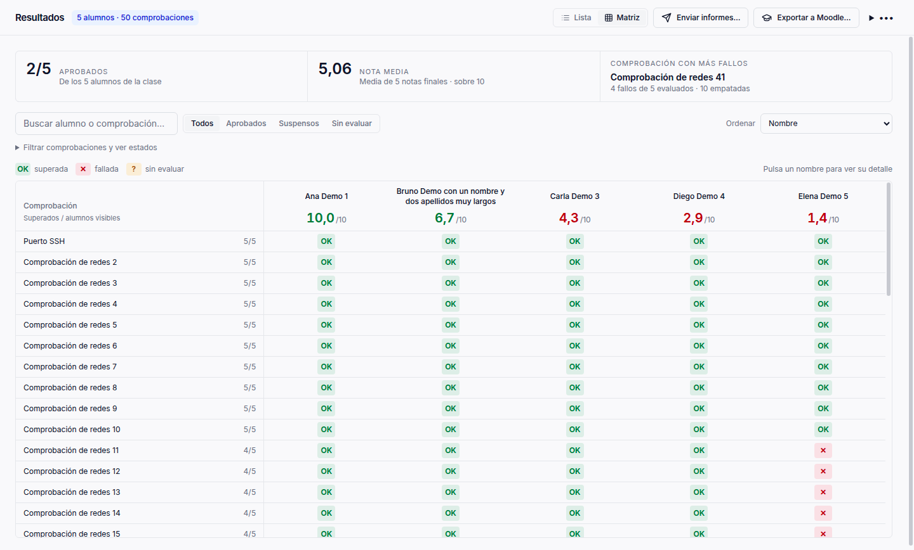

<p align="center">
  
</p>

<h1 align="center">Heimdall</h1>

<p align="center">
  <strong>Corrige por SSH las prácticas de sistemas y redes de toda la clase a la vez.</strong><br>
  Escribes el examen en YAML, eliges la clase y Heimdall pone las notas.
</p>

<p align="center">
  
  
  
</p>

---

Heimdall entra por SSH en la máquina de cada alumno, comprueba que los
servicios, la configuración y la red están como se pidió y calcula la nota.

```
tu clase + tu examen.yaml  →  Heimdall  →  máquinas del alumnado  →  notas e informes
```

Cada comprobación termina en uno de tres estados: **bien**, **mal** o **sin
evaluar**. Una máquina apagada no es un trabajo mal hecho: sale *sin evaluar*,
con el motivo escrito, nunca con un 0.

El nombre viene del guardián de la mitología nórdica, el que vigila sin
descanso.

## Empezar en cinco pasos

**Instalar.** Descarga el `.deb` o el AppImage de la
[última versión](https://github.com/adr1mt/Heimdall/releases/latest). Linux de
64 bits. El motor de corrección va dentro: no hay nada más que instalar.

```bash
sudo apt install ./Heimdall-1.0.0.deb
```

Si prefieres el AppImage, dale permiso de ejecución y ábrelo:

```bash
chmod +x Heimdall-1.0.0.AppImage
./Heimdall-1.0.0.AppImage
```

El AppImage publicado no necesita `libfuse2`.

### 1. Crea tu clase

**Clases → Nueva clase.** Una vez por curso y se reutiliza en todos los
exámenes. De cada alumno apuntas:

| Dato | Para qué | Ejemplo |
|---|---|---|
| Identificador | cómo se le nombra en el examen | `alu01` |
| Nombre | para leerlo en pantalla | `Alumna Primera` |
| Contacto | correo o identificador de Moodle, para exportar las notas | `alu01@centro.cat` |
| Máquina | la IP de su equipo | `10.0.2.31` |

Y para toda la clase, el **usuario** y la **contraseña** con que se entra en
las máquinas. Si un alumno usa otro usuario u otro puerto SSH, se cambia solo
el suyo.

### 2. Carga tu examen

**Inicio → Abrir…** si ya tienes la carpeta del examen, o **Inicio → Nuevo…**
para escribirlo o pegarlo en el editor. El examen es un fichero de texto en
YAML; más abajo está [cómo se escribe](#el-examen-qué-es-ese-yaml) y
[cómo pedírselo a una IA](#pídeselo-a-una-ia).

Al guardar, Heimdall lo valida: si hay un error, te dice la línea y no deja
corregir hasta arreglarlo.

### 3. Corrige

En **Corregir** eliges la clase y tienes dos formas:

- **Una vez**: corrige a toda la clase y termina. Para el final de la práctica.
- **Modo examen**: corrige la clase una y otra vez cada X minutos (5 como
  mínimo) mientras dura la práctica. Cada alumno se queda con su mejor vuelta.

### 4. Mira los resultados

**Resultados** se actualiza en tiempo real, en **lista** o en **matriz** (una
fila por comprobación, una columna por alumno). Al pulsar una casilla ves qué
se ejecutó, qué contestó la máquina y qué se esperaba.

Puedes filtrar por **Aprobados**, **Suspensos** o **Sin evaluar**, buscar y
ordenar por nombre, nota o número de comprobaciones falladas. La matriz
mantiene visibles los nombres y las comprobaciones al desplazarte. El resumen
destaca la comprobación con más fallos y calcula la media de las notas finales;
las provisionales no entran en ella.

El **modo proyector** agranda la letra y tapa las IP para enseñar el progreso
en clase. **Analíticas** te dice quién necesita atención, qué comprobaciones
falla más la clase y cómo se reparten las notas.

### 5. Entrega las notas

- **Enviar informes…**: cada alumno recibe en su carpeta personal, en su
  máquina, un informe con su nota, un resumen **Qué debes revisar** con hasta
  ocho comprobaciones falladas y el desglose completo. Solo el suyo: sin
  comandos, sin contraseña, sin datos de los demás. Heimdall te dice a quién
  le ha llegado y por qué no a los demás. Se puede abrir en el navegador e
  imprimir en A4.
- **CSV de Moodle** y **hoja de notas**, en la escala que elijas en Ajustes
  (sobre 10, sobre 100…).

## El examen: qué es ese YAML

Un examen es un fichero `examen.yaml`: una lista de **comprobaciones**
agrupadas. Cada una dice en qué máquina se ejecuta, qué **comando** se lanza y
qué tiene que aparecer en lo que contesta.

```yaml
examen: "RA1 · Servidor DHCP con KEA"
version: 1
hosts: [host1]

por_defecto:
  peso: 1
  timeout: 20s

grupos:
  - grupo: "KEA"
    comprobaciones:
      - id: kea-subred
        descripcion: "KEA declara la subred 10.0.0.0/8"
        en: host1
        sudo: true          # /etc/kea solo lo lee el administrador
        cmd: ["cat", "/etc/kea/kea-dhcp4.conf"]
        cerca_de: { ancla: '"subnet"', lineas: 0, contiene: "10.0.0.0/8" }

      - id: kea-activo
        descripcion: "El servicio kea-dhcp4-server está activo"
        en: host1
        peso: 2
        cmd: ["systemctl", "is-active", "kea-dhcp4-server"]
        igual_a: "active"
```

Lo que hay que saber:

- **El comando va como lista de palabras**: `["ip", "address", "show"]`. No
  hay tuberías (`|`), ni `grep`, ni `;`: en vez de filtrar con `grep`, se usa
  una de las comprobaciones de abajo.
- **Cada comprobación lleva una, y solo una, de estas**:

  | Clave | Aprueba si la respuesta… |
  |---|---|
  | `contiene: "texto"` | contiene ese texto |
  | `no_contiene: "texto"` | no lo contiene |
  | `igual_a: "texto"` | es exactamente ese texto |
  | `exit_code: 0` | el comando termina con ese código |
  | `cerca_de: { ancla, lineas, contiene }` | contiene el texto como mucho N líneas después de la línea que tiene el ancla (como `grep -A N`) |

- `sudo: true` ejecuta el comando como administrador, para lo que el usuario de
  la conexión no puede leer (`/etc/kea` en Ubuntu 26.04, `nft list ruleset`).
  Usa la contraseña de la clase, la misma de la conexión: nunca la escribas en
  el examen. Va en la comprobación o en `por_defecto` para todas. Si la
  máquina no la acepta, la comprobación sale *sin evaluar*, no suspendida.
- `peso` es lo que vale cada comprobación (por defecto, el de `por_defecto`).
  La nota es la suma de lo aprobado sobre la suma total, y el total es el
  mismo para todos.
- `${alumno.campo}` usa un dato propio de cada alumno que hayas añadido a la
  clase (su subdominio, su puerto…).
- No hay expresiones regulares, bucles ni condicionales. Las contraseñas nunca
  van en el examen.

La referencia completa está en [docs/design/02-FORMATO.md](docs/design/02-FORMATO.md).

## Pídeselo a una IA

Copia esto, cambia la última línea por tu práctica y pega el resultado en el
editor. Revísalo antes de corregir: la IA puede inventarse rutas o servicios.

```text
Escríbeme un examen para Heimdall en YAML con este formato exacto:

examen: "<título>"
version: 1
hosts: [host1]
por_defecto: { peso: 1, timeout: 20s }
grupos:
  - grupo: "<nombre del grupo>"
    comprobaciones:
      - id: <identificador-corto-sin-espacios>
        descripcion: "<qué se comprueba, en una frase>"
        en: host1
        cmd: ["comando", "argumento", "argumento"]
        <UNA sola aserción>

Reglas:
- cmd es una lista de palabras. Sin tuberías, sin grep, sin ; ni redirecciones.
- Si el comando necesita ser administrador (leer /etc/kea, nft list ruleset...),
  añade sudo: true a esa comprobación. Nunca escribas sudo ni contraseñas en cmd.
- Aserciones posibles (una por comprobación): contiene: "x", no_contiene: "x",
  igual_a: "x", exit_code: 0, o cerca_de: { ancla: "x", lineas: N, contiene: "y" }
  (busca "y" en las N líneas siguientes a la que contiene "x").
- Nada de expresiones regulares, bucles ni condicionales.
- Compara datos estables (ficheros de configuración, systemctl is-active,
  ip address), nunca mensajes que dependan del idioma del sistema.
- peso: N solo si una comprobación vale más que las demás.
- Devuélveme solo el YAML.

La práctica: <describe aquí lo que tiene que haber configurado el alumno>.
```

## Las reglas de la nota

1. **Un error técnico nunca es un suspenso.** Una máquina apagada sale *sin
   evaluar*, con el motivo escrito.
2. **Si queda algo sin evaluar, no hay nota final**, solo una provisional
   marcada. Se repite lo que faltó y entonces sí.
3. **Todos reciben las mismas comprobaciones y los mismos pesos**, fijados
   antes de tocar ninguna máquina.
4. **Ningún alumno puede bloquear la corrección de los demás**, y ningún
   comando puede colgarla.
5. **La contraseña no aparece** en notas, informes, registros ni en `ps`.

## Así se ve



La matriz reúne las notas y las comprobaciones de toda la clase. Si una máquina
está apagada, sus comprobaciones salen **sin evaluar** y el resto de la clase
puede continuar.

<sub>Interfaz actual con datos ficticios de cinco alumnos y 50 comprobaciones;
captura de la verificación visual de Resultados.</sub>

También puedes ver un [informe individual de ejemplo](docs/reviews/evidence/T193/corto.html)
y su [impresión en PDF](docs/reviews/evidence/T193/corto.pdf), con datos ficticios.

## Estado

**Versión 1.0.0**: completa y empaquetada en `.deb` y AppImage con el motor
dentro. Queda pendiente corregir con ella un examen real de aula de principio
a fin.

La rama `main` incluye mejoras posteriores en la matriz de resultados, los
filtros, el cálculo de la media mostrada y los informes individuales que se
describen y muestran aquí. Para tenerlas antes de la próxima publicación,
consulta cómo [compilar desde el código fuente](docs/DESARROLLO.md).

## Documentación

| Necesitas… | Lee |
|---|---|
| La guía completa para corregir | [docs/GUIA.md](docs/GUIA.md) |
| El formato del examen y de la clase | [docs/design/02-FORMATO.md](docs/design/02-FORMATO.md) |
| Qué trae cada versión | [docs/NOTAS-DE-VERSION.md](docs/NOTAS-DE-VERSION.md) |
| Compilarlo o probarlo | [docs/DESARROLLO.md](docs/DESARROLLO.md) |
| Por qué está montado así | [docs/adr/](docs/adr/) |

## Licencia

El código de este repositorio está bajo la [Mozilla Public License 2.0](LICENSE).
