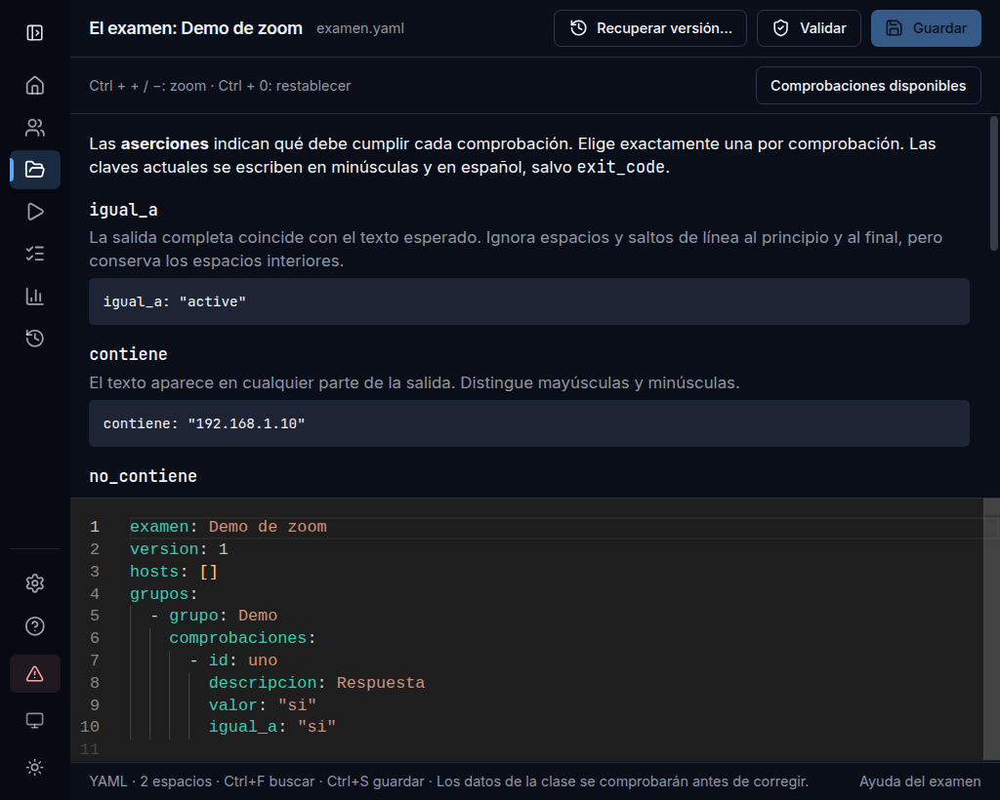

# T235 · Zoom y ayuda de comprobaciones

Fecha: 2026-11-05. Base: `88e5ad6`. Implementación local, sin instalación,
publicación ni cambios en notas. Propuesta autorizada por el usuario.

## Resultado

- Ctrl + más (también igual), menos y cero controlan la escala guardada entre
  80 y 120 %. El selector existente de Resultados usa el mismo estado.
- Escala CSS completa, incluido Monaco, en lugar de cambiar solo la fuente
  raíz. El menú nativo no aplica un segundo zoom a estos atajos.
- Panel «Comprobaciones disponibles» en el editor y sección equivalente en el
  manual. Describe las cinco aserciones, ejemplos, normalización, stdout,
  texto literal, una aserción por comprobación y ausencia segura.
- El panel conserva el borrador y no escribe el examen.
- Auditoría AutoCheck conservada en `docs/research/AUTOCHECK-2026-11-05.md`;
  siguientes fases autorizadas T229–T234 en TASKS, aún sin implementar.

## Verificación

- `GOCACHE=/tmp/heimdall-go-cache make check`: correcto.
- `npm run typecheck`: correcto.
- `npm test -- --maxWorkers=2`: 47 archivos, 648 pruebas correctas fuera del
  sandbox. Dentro del sandbox fallaron cuatro pruebas de procesos hijos
  (backup-recovery y shutdown) por timeout; repetir con menos trabajadores no
  lo corrigió. No se modificaron pruebas ni sus límites.
- `make gui-build`: compilación y verificación de preload correctas.
- `make docs-check tools-check`: enlaces correctos y 11 pruebas de herramientas.
- Arnés `gui/scripts/zoom-help-lab.ts`: proceso principal real, menú nativo,
  preload, renderer y Monaco con perfil/examen temporales. Verifica atajos con
  foco real de edición, extremos 80/120, reset, ausencia de zoom nativo doble,
  persistencia tras recarga, cinco aserciones, borrador y fuente conservados.
  Sin SSH ni alumnado real. El primer intento del arnés necesitó corregir su
  simulación de foco/pegado; el segundo completó todos los criterios.
- Capturas inspeccionadas a 120 % en ventanas de 1024 y 1280 px.



## Repetir el arnés

Desde `gui/`, después de compilar:

```bash
node_modules/.bin/esbuild scripts/zoom-help-lab.ts --bundle --platform=node --format=cjs --outfile=out/main/zoom-help-lab.cjs --external:electron
node_modules/electron/dist/electron out/main/zoom-help-lab.cjs --no-sandbox
```

Electron no arranca dentro del sandbox de herramientas de Codex: falla con
`sandbox_host_linux.cc: Operation not permitted`. El arnés se ejecutó fuera
de ese aislamiento; `--no-sandbox` solo pertenece a esta prueba local.

Node disponible en esta sesión: 24.22.1; la toolchain Node 26 documentada no
se ha reproducido. No se ha instalado el paquete habitual ni realizado una
corrección de aula. El teclado numérico comparte las teclas lógicas admitidas,
pero no se ha probado un teclado físico numérico. El proyector conserva su
escala propia y sus pruebas existentes; no se repitió un laboratorio de aula.
